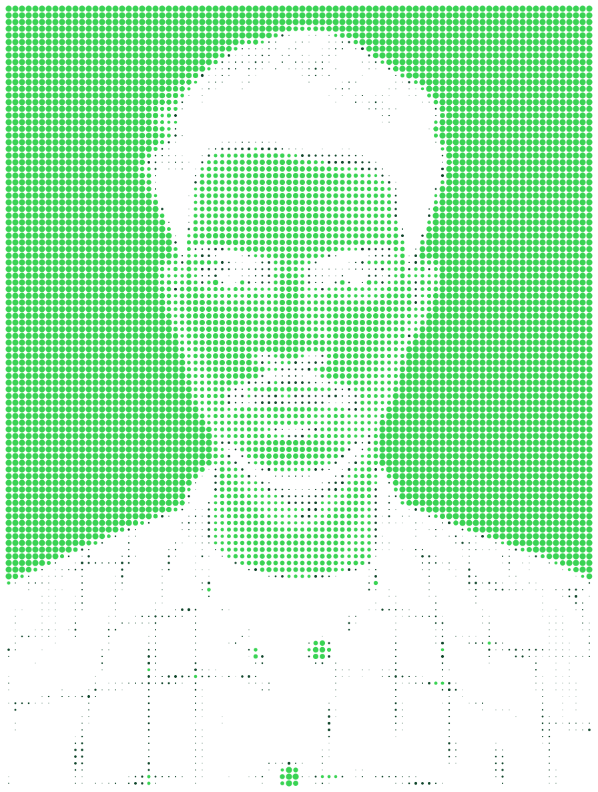
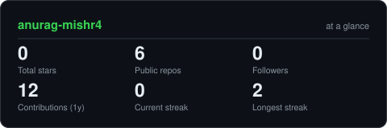

<div align="center">

<!-- PORTRAIT - generated by scripts/dotify.py from assets/jacket.png.
     Colour mode, so one file serves both GitHub themes. -->
<picture>
  <source media="(prefers-color-scheme: dark)" srcset="assets/portrait-dark.svg">
  <source media="(prefers-color-scheme: light)" srcset="assets/portrait-light.svg">
  
</picture>

<br>

<!-- NAME / TAGLINE - animated typing -->

<a href="https://github.com/anurag-mishr4">
  
</a>


<br>

<!-- SOCIAL LINKS -->
<a href="https://linkedin.com/in/anurag-mishra-a240452b8">
  
</a>
<a href="mailto:anurag232m@gmail.com">
  
</a>
<a href="https://codeforces.com/profile/anurag-mishr4">
  
</a>
<a href="https://leetcode.com/u/anurag-mishra-7">
  
</a>

<br>


</div>

---

## `~/` whoami

```console
$ cat about.txt
```

Hi, I'm **Anurag Mishra**, a Computer Science and Engineering student with an interest in software development and emerging technologies.

I'm focused on strengthening my programming fundamentals, improving problem-solving skills, and building practical projects.

- Currently learning **C and Python**
- Exploring **Web Development and Software Engineering**
- Practicing **Data Structures and Algorithms**
- Interested in **Open Source, Hackathons, and Technology**
- Continuously learning and building through hands-on practice

<br>

<div align="center">

## `~/` toolbox


</div>

---

<div align="center">

## `~/` skill radar

<table>
<tr>
<td width="50%" align="center" valign="middle">

<!-- Self-rated radar chart -->
<picture>
  <source media="(prefers-color-scheme: dark)" srcset="assets/radar-dark.svg">
  <source media="(prefers-color-scheme: light)" srcset="assets/radar-light.svg">
  
</picture>

</td>
<td width="50%" align="center" valign="middle">

<!-- Programming language statistics -->
<picture>
  <source media="(prefers-color-scheme: dark)" srcset="assets/radar-langs-dark.svg">
  <source media="(prefers-color-scheme: light)" srcset="assets/radar-langs-light.svg">
  
</picture>

</td>
</tr>
</table>

</div>

---

<div align="center">

## `~/` contribution calendar

<!-- 3D isometric contribution calendar -->


<br><br>

<!-- Contribution snake animation -->
<picture>
  <source media="(prefers-color-scheme: dark)" srcset="https://raw.githubusercontent.com/anurag-mishr4/anurag-mishr4/output/snake-dark.svg">
  <source media="(prefers-color-scheme: light)" srcset="https://raw.githubusercontent.com/anurag-mishr4/anurag-mishr4/output/snake.svg">
  
</picture>

</div>

---

<div align="center">

## `~/` GitHub stats

<!-- Generated statistics cards -->
<picture>
  <source media="(prefers-color-scheme: dark)" srcset="assets/card-stats-dark.svg">
  <source media="(prefers-color-scheme: light)" srcset="assets/card-stats-light.svg">
  
</picture>

<br>


<br><br>


</div>

---

<div align="center">

## `~/` selected projects

### Personal Portfolio Website

A responsive personal portfolio built using **HTML, CSS, and JavaScript** to showcase my profile, skills, and development journey.

<br>

*More projects coming soon.*

</div>

---

<div align="center">

<sub>01110100 01101000 01100001 01101110 01101011 01110011 00100000 01100110 01101111 01110010 00100000 01110011 01100011 01110010 01101111 01101100 01101100 01101001 01101110 01100111</sub>

<br>

**Thanks for visiting my profile!**

</div>
